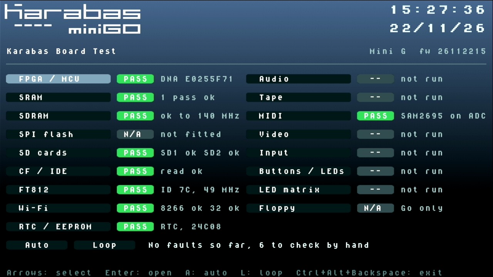

# Karabas Board Test

[Русская версия](README.ru.md)

The board test core of the Karabas Go, Mini and Mini G (Xilinx Spartan-6 XC6SLX25), "Karabas Board
Test" in the core list (`boardtest.kg`). One core in place of the old test and sdram-test cores.

A VexRiscv CPU with all its code and its screen in block RAM draws a UI in the style of the boot
menu and runs the tests. The SRAM and the SDRAM are never used by the UI, so they get full
destructive tests in hardware, and the core still runs and names the fault on a board with a dead
memory chip.

## Checks

| Group | What | Boards |
|---|---|---|
| FPGA / MCU | DNA, board, firmware build, the MCU link | all |
| SRAM | data / address lines with the shorted / open line named, byte lanes, march C-, random, the read margin | all |
| SDRAM | the same at 84 ... 140 MHz with the read delay found per clock; PASS = clean up to 120 MHz | all |
| SD cards | SD1 of the MCU (type, size, FS, free space; firmware v26112215+), SD2: start, CID, CSD, sector 0, speed | all |
| CF / IDE | IDENTIFY, sector 0, speed, D0..D15 (read only) | all (Mini G: the shield) |
| FT812 | wake-up, REG_ID, its clock | all |
| Wi-Fi | ESP8266: AT, version, scan, CTS; ESP32 (ZiFi32): version | all / Mini G |
| RTC / EEPROM | DS3231 ticking and its date, 24C08, the I2C bus | all |
| Audio, Tape, MIDI | tones L / R (a DAC -> line in cable is measured), tape in / out, the SAM2695 heard on the ADC | all |
| Video | colour bars, ramps of each DAC bit | all |
| Input, Buttons / LEDs, LED matrix | keyboard, mouse, pads, the front buttons and LEDs, the matrix add-on | all |
| Floppy | drive A: speed by INDEX, track 0, write protect, flux (read only) | Go |

**Auto** (key A) runs the checks that need no operator one after the other, the SDRAM last, and
shows the verdict of the board; **Loop** (key L) repeats it (a group that failed once stays FAIL).
Esc stops. Nothing is written to a card, a drive or the settings of a module. An empty slot or a
missing module is N/A, not FAIL. Leave the core with Ctrl+Alt+Backspace.

Docs (in Russian): [docs/PLAN.md](docs/PLAN.md), [docs/BACKLOG.md](docs/BACKLOG.md).

## Build

`make -C src` (ISE 14.7, the `riscv-none-elf-gcc` of xPack for the program) writes `src/boardtest.kg`
for all three boards; `make -C src minig` one board. Simulations: `src/sim/soc/run_sim.sh`,
`src/sim/mem/run_*_sim.sh`, `src/sim/per/run_per_sim.sh`; frames of all pages: `src/sw/host/run.sh`.

## License

MIT, see [LICENSE](LICENSE).
