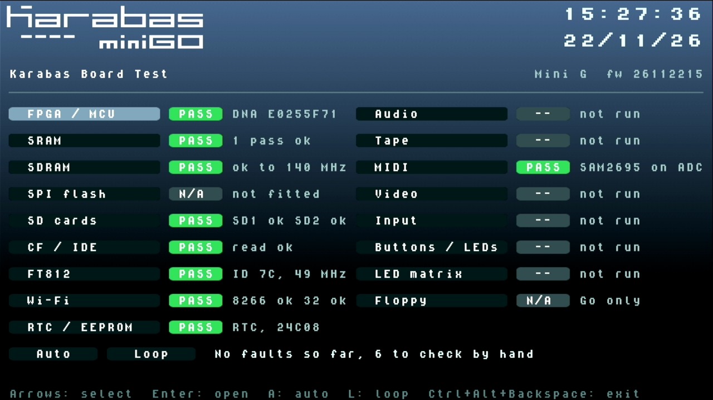

# Karabas Board Test

[English version](README.md)

Ядро проверки плат Karabas Go, Mini и Mini G (Xilinx Spartan-6 XC6SLX25), в списке ядер — «Karabas
Board Test» (`boardtest.kg`). Одно ядро вместо старых test и sdram-test.

Процессор VexRiscv, у которого весь код и экран лежат в блочной памяти FPGA, рисует интерфейс в
стиле загрузочного меню и ведёт проверки. SRAM и SDRAM интерфейсом не заняты, поэтому проверяются
полностью разрушающими аппаратными тестами, а ядро работает и называет неисправность даже на плате с
мёртвой микросхемой памяти.

## Проверки

| Группа | Что | Платы |
|---|---|---|
| FPGA / MCU | DNA, плата, версия прошивки, связь с MCU | все |
| SRAM | линии данных / адреса с названием замкнутой / оборванной, байтовые половины, march C-, случайные, запас по чтению | все |
| SDRAM | то же на 84 … 140 МГц с подбором задержки чтения; PASS — без ошибок до 120 МГц | все |
| SD cards | SD1 MCU (тип, объём, ФС, свободно; прошивка v26112215+), SD2: запуск, CID, CSD, сектор 0, скорость | все |
| CF / IDE | IDENTIFY, сектор 0, скорость, D0..D15 (только чтение) | все (Mini G — шилд) |
| FT812 | пробуждение, REG_ID, его частота | все |
| Wi-Fi | ESP8266: AT, версия, поиск сетей, CTS; ESP32 (ZiFi32): версия | все / Mini G |
| RTC / EEPROM | ход DS3231 и дата, 24C08, шина I2C | все |
| Audio, Tape, MIDI | тоны L / R (с кабелем DAC → line in — измерение), лента вход / выход, SAM2695 слышен через ADC | все |
| Video | цветные полосы, градиенты по битам ЦАП | все |
| Input, Buttons / LEDs, LED matrix | клавиатура, мышь, геймпады, кнопки и светодиоды платы, приставка-матрица | все |
| Floppy | дисковод A: обороты по INDEX, дорожка 0, защита записи, поток (только чтение) | Go |

**Auto** (клавиша A) запускает одну за другой проверки, которым не нужен оператор (SDRAM —
последней), и показывает итог платы; **Loop** (клавиша L) повторяет их по кругу (группа, упавшая
хоть раз, остаётся FAIL). Esc — стоп. На карты, диски и в настройки модулей ничего не пишется. Пустой
слот или отсутствующий модуль — N/A, не FAIL. Выход из ядра — Ctrl+Alt+Backspace.

Документы: [docs/PLAN.md](docs/PLAN.md), [docs/BACKLOG.md](docs/BACKLOG.md).

## Сборка

`make -C src` (ISE 14.7, для программы — `riscv-none-elf-gcc` из xPack) собирает `src/boardtest.kg`
для всех трёх плат; `make -C src minig` — одну плату. Симуляции: `src/sim/soc/run_sim.sh`,
`src/sim/mem/run_*_sim.sh`, `src/sim/per/run_per_sim.sh`; кадры всех страниц: `src/sw/host/run.sh`.

## Лицензия

MIT, см. [LICENSE](LICENSE).
